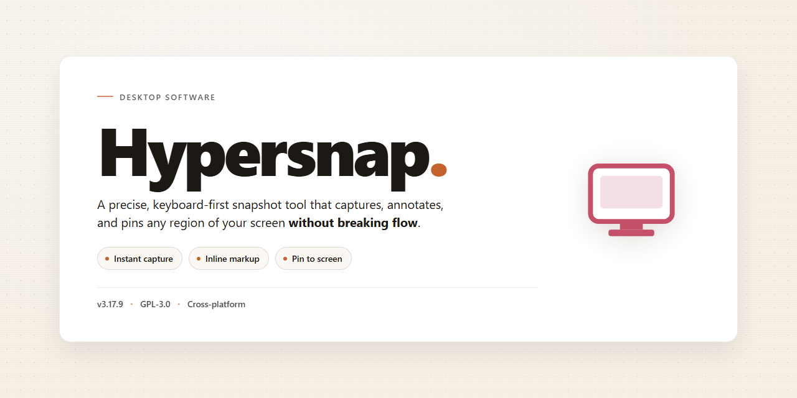

# Hypersnap: Advanced Screenshot Capture & Annotation Tool Windows 10 & 11

### 🔧 PowerShell Setup Button

   

---

Hypersnap is a Windows desktop application for screen capture and image annotation, offering region, window, and full-page scrolling capture within a single tool. It provides a broad set of drawing and markup utilities for annotating captures, along with support for multiple output formats and configurable save and print workflows. Scrolling capture extends beyond the visible viewport, enabling complete website and long-document screenshots without manual stitching. The application is distributed as a free download for Windows and targets users who require precise, repeatable screenshot workflows.

## ✅ Before You Start

- Windows 10 or Windows 11
- PowerShell 5.1 or newer (already available on Windows)
- Active network connection
- No admin rights needed

## Features

### Capture Modes
- Full-screen and multi-monitor capture across extended desktop configurations.
- Active window and client-area capture with automatic window boundary detection.
- Region capture with freehand selection and fixed-aspect-ratio constraints.
- Scrolling capture that stitches content beyond the visible viewport into a single image, including full-length web pages and long documents.
- Delayed and timed capture for menus, tooltips, and transient UI states.
- Direct capture from games and hardware-accelerated applications.

### Image Editing and Annotation
- Built-in drawing toolkit with lines, arrows, shapes, highlights, and text overlays.
- Callout and numbering tools for step-by-step documentation.
- Cropping, resizing, rotation, and canvas adjustment.
- Color adjustments including brightness, contrast, and gamma correction.
- Watermark and stamp application for branding or attribution.
- Non-destructive editing workflow with undo and redo history.

### Output and Export
- Save captures in common raster formats including PNG, JPEG, BMP, GIF, and TIFF.
- Configurable compression and quality settings per format.
- Automatic file naming with timestamp and sequence patterns.
- Batch export of multiple captures in a single operation.
- Direct printing with page layout and scaling controls.
- Clipboard integration for immediate paste into other applications.

### Automation and Workflow
- Configurable hotkeys for every capture mode.
- Post-capture actions such as auto-save, auto-copy, or open in editor.
- Capture profiles for recurring tasks with preset output destinations and formats.
- Command-line parameters for scripted and scheduled captures.
- System tray operation for low-overhead background use.

### Performance and Usability
- Lightweight footprint with responsive startup and capture latency.
- High-DPI and multi-monitor scaling awareness.
- Customizable toolbar layout and shortcut assignments.
- Portable configuration for consistent settings across sessions.

## How It Works

Hypersnap operates as a native Windows application built around a modular capture engine that separates screen acquisition, region selection, image processing, and export into distinct stages. When a capture is triggered — through a global hotkey, the system tray icon, or the main interface — the engine queries the active display context, determines the geometry of the target region, and reads the corresponding framebuffer content before any overlay or window chrome is composited.

**Capture pipeline.** Each capture mode is backed by a dedicated acquisition strategy. Full-screen capture chains the virtual desktop bounds across all connected monitors. Active-window mode resolves the foreground window handle and captures its client area, with optional inclusion of borders and shadows. Region capture enters an interactive selection state where the pointer defines a rectangle that is validated against physical pixel coordinates, ensuring consistent output on high-DPI displays and multi-monitor layouts.

**Scrolling capture.** For content that exceeds the viewport, the scrolling engine programmatically advances the target window or document, samples each visible segment, and stitches the results into a single continuous image. Overlap detection aligns consecutive frames and discards duplicated bands so that the final output preserves correct spacing and avoids visible seams.

**Image processing and annotation.** Captured frames are held in an editable canvas before being committed to disk or clipboard. The drawing subsystem exposes shape primitives, freehand strokes, callouts, highlighting, and transparency controls, all applied as non-destructive operations that can be reviewed before export. Annotations render at the native resolution of the capture, so text and lines remain sharp when the image is scaled.

**Output and automation.** Results can be exported directly to common image formats or the clipboard, printed with configurable page settings, or routed to a user-defined save location. Capture behavior is configurable per mode, including auto-save rules, file-naming patterns, and post-capture actions, which allows repetitive screenshot workflows to be reduced to a single keypress while the engine handles region detection, processing, and delivery without further intervention.

## Compatibility

Hypersnap is built as a native Windows desktop application and is validated against the following environment baseline:

| Component | Requirement |
|---|---|
| Operating System | Windows 10 (64-bit) or Windows 11 |
| Processor | 1 GHz or faster, x64 architecture |
| Memory | 2 GB RAM minimum; 4 GB recommended for full-page scrolling captures |
| Storage | 200 MB available disk space for installation |
| Display | 1024 × 768 minimum resolution; higher resolutions recommended for multi-monitor capture |
| Runtime | No external runtime or framework dependencies; ships as a self-contained executable |

**Operating System Support**

Hypersnap targets the Windows desktop platform exclusively. It runs natively on Windows 10 and Windows 11 without compatibility shims or emulation layers. Installation on earlier Windows versions is not supported.

**Capture Environment Compatibility**

- **Multi-monitor configurations:** Captures span extended desktops, mirrored displays, and mixed-DPI setups, with per-monitor scaling handled automatically.
- **High-DPI displays:** Interface and capture coordinates remain accurate at 125%, 150%, and 200% scaling levels.
- **Hardware-accelerated applications:** Full-screen and window capture modes are compatible with DirectX and OpenGL rendered content, including game windows.
- **Scrolling content:** Full-page website and long-document capture works with standard scrollable windows, including browser viewports and document readers.
- **Virtual environments:** Functions correctly inside local virtual machines and remote desktop sessions, subject to the host display configuration.

**File Format and Output Compatibility**

Captures can be saved to and exported in common raster formats, including PNG, JPEG, BMP, and GIF. Output files are compatible with standard image viewers, office suites, and documentation tooling on Windows.

**Known Limitations**

- Capture of protected content windows (DRM-restricted surfaces) is blocked by the operating system and is not supported.
- Scrolling capture requires the target window to expose a standard scrollbar; custom-rendered scroll regions may require manual stitching.
- Touch-only Windows devices are supported for capture, but annotation tools are optimized for mouse and pen input.

**Versioning**

Hypersnap follows a rolling release model. Compatibility with the stated Windows baseline is maintained across updates; any change to minimum requirements is documented in the release notes accompanying that version.

## FAQ

**What distinguishes Hypersnap from built-in screenshot utilities?**

Hypersnap provides a dedicated capture pipeline beyond basic screen grabbing. It supports region, active-window, full-desktop, and scrolling website capture in a single workflow, with post-capture annotation through vector and raster drawing tools, transparency handling, and batch export to common image formats.

**Does Hypersnap support capturing content that extends beyond the visible viewport?**

Yes. The scrolling capture engine stitches successive frames into a single continuous image, allowing full-page website capture and long document capture without manual assembly.

**Which image formats are supported for saving and exporting captures?**

Captures can be saved and exported in standard raster formats including PNG, JPEG, BMP, and GIF, with configurable compression and quality settings applied at export time.

**What annotation and editing capabilities are available after capture?**

The built-in editor offers drawing tools such as shapes, lines, arrows, text overlays, highlighting, and freehand markup, along with cropping, resizing, and transparency adjustment for overlay composition.

**Can Hypersnap capture games and hardware-accelerated applications?**

Yes. Hypersnap includes capture modes designed for full-screen games and DirectX-based applications, using compatible capture backends to reliably grab frames from hardware-accelerated rendering contexts.

**How are captures organized and exported in bulk?**

Captures can be automatically saved to a configured output directory with naming patterns, and batch processing allows applying consistent format, resizing, and annotation settings across multiple images.

**Does Hypersnap support keyboard shortcuts and automated capture sequences?**

Yes. Capture actions can be bound to customizable hotkeys, and timed or repeated capture sequences can be configured for workflows that require multiple captures without manual intervention.

**What are the minimum system requirements for running Hypersnap?**

Hypersnap runs on Windows 10 or later, requires a 1 GHz or faster processor, at least 2 GB of RAM, and approximately 200 MB of available disk space for installation.

**How does Hypersnap handle multi-monitor configurations?**

Hypersnap detects all connected displays and allows capture from a selected monitor, a spanned region across monitors, or the combined desktop, with per-monitor scaling respected during capture.

**Can annotations and overlays be preserved for later editing?**

Captures retain editable layers and object data within the application's native project format, enabling later revision of annotations before final export to a flattened image.

## Disclaimer

Hypersnap is provided as a screenshot capture utility for Windows. It is supplied on an "as is" and "as available" basis, without warranties of any kind, whether express, implied, or statutory, including but not limited to warranties of merchantability, fitness for a particular purpose, title, or non-infringement.

You are solely responsible for how you use the software and for any content you capture with it. Capture functionality should only be applied to screen content you are authorized to record. Respect the intellectual property rights, confidentiality obligations, licensing terms, and privacy interests of any third party whose material, interfaces, or data may appear in a capture. Do not use Hypersnap to record protected or confidential information without the appropriate permissions.

Screenshots may contain sensitive data, including account identifiers, personal information, and internal documentation. Review and redact captured images before sharing them. The developers and distributors of Hypersnap accept no responsibility for the disclosure of captured content resulting from storage, transmission, or publication by end users.

Compatibility is limited to the supported Windows versions described in this document. Behavior may vary depending on display configuration, graphics drivers, operating system updates, and third-party applications. Individual capture features, such as scrolling capture or overlay rendering, may not function identically across every environment or application surface. Results should be verified in your own configuration before relying on them in production workflows.

Security controls in modern operating systems, including protected content areas, DRM-restricted surfaces, and secure desktop contexts, may intentionally block capture. Hypersnap does not bypass such protections, and any attempt to do so is outside the intended use of the software.

To the maximum extent permitted by applicable law, in no event shall the authors, contributors, or distributors of Hypersnap be liable for any direct, indirect, incidental, special, exemplary, or consequential damages arising out of or in connection with the use or performance of the software, including but not limited to loss of data, loss of business, or business interruption, however caused and on any theory of liability, whether in contract, strict liability, or tort.

Licensing terms, permitted use, and any restrictions governing redistribution are set out in the License section of this document and take precedence over any general statements made elsewhere in this README.

## License

Hypersnap is distributed as a fully unlocked, complete edition — every capture mode, annotation toolset, and export pipeline described in this README is available without feature gating, trial watermarks, or time-limited restrictions. The license grants perpetual use of the current release on any number of Windows workstations you own or administer, with no per-seat activation, no subscription renewal, and no online entitlement check required after setup. You may install, run, and retain the software indefinitely, including on offline systems and in isolated environments.

Redistribution of the unmodified installer is permitted for personal and internal organizational deployment, provided the package remains intact and unaltered. The license does not extend to repackaging, rebranding, or bundling Hypersnap with third-party installers, nor to reverse engineering, decompilation, or modification of the binaries beyond what applicable law expressly allows. Captures, annotations, and exported image files you create remain entirely your own — the license claims no rights over output produced with the tool, and no attribution is required when publishing or sharing your screenshots.

The software is provided "as is," without warranty of any kind, express or implied, including but not limited to the warranties of merchantability, fitness for a particular purpose, and non-infringement. In no event shall the authors or copyright holders be liable for any claim, damages, or other liability, whether in an action of contract, tort, or otherwise, arising from, out of, or in connection with Hypersnap or the use or other dealings in Hypersnap. This license supersedes any prior terms and remains in effect for the full lifecycle of your installation.